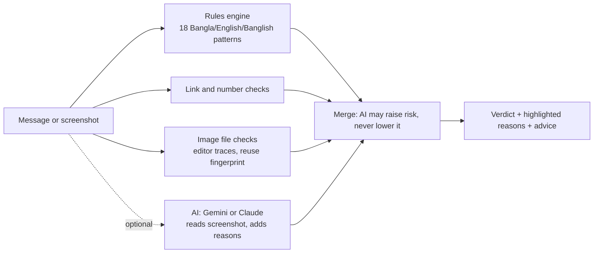

# Scam Shield: Mobile Money Scam Shield

**Live:** https://scam-shield-two-topaz.vercel.app  
Team **JU_Segfault** (Jahangirnagar University), CoU AI Hackathon 2026

Bangladesh runs on bKash, Nagad and Rocket. So do its scammers: fake "payment done" screenshots sent to online sellers, "wrong number, please send it back" calls, fake customer care asking for a PIN or OTP. Scam Shield checks *before* you act, in Bangla and English, and shows exactly why.

## What it does

| Tool | For | What happens |
|---|---|---|
| **Payment proof** | Online sellers | Upload the buyer's screenshot, alone or with what you expected. **Screenshot alone:** editing-app traces in the file, the same screenshot or TrxID reused for another order, the phone's status-bar clock earlier than the payment time (impossible), a pending or failed screen, a payment days old, and the AI's look for tampered digits. **With your details:** amount (paying less fails, a little more is a warning), the buyer's number as the sender and your number as the receiver (all optional; swapped numbers are explained, masked numbers like 017XXXXX678 are compared on their visible digits), and the payment time (within an hour passes; AM/PM slips are recognised). **A wrong transaction ID makes the whole payment LIKELY FAKE**, whatever else matches: an impossible ID (wrong length, symbols, a bKash ID that is not 10 characters, 1234567890-style patterns), or an ID already used for another order. Verdict: *matches / no red flags / suspicious / likely fake*, never "safe". |
| **Message check** | Everyone | Paste an SMS or describe a call (Bangla, English, Banglish), or record it: Record, Pause/Resume, then Check voice turns the recording into text (Gemini speech-to-text, falling back to the browser's own recognition) and checks it. The exact risky words are highlighted, links and phone numbers are judged (look-alike domains, hidden short links, personal numbers posing as customer care), and you get plain advice plus official hotlines. |
| **Screen check** (in Message check) | Everyone | Press **Scan a screen**, then choose **Camera** (point at a phone showing a call or message), **Share my screen** (live: WhatsApp Web, Messenger or a phone-mirroring window; optional auto re-check when the screen changes) or **Upload screenshot** (or paste one with Ctrl+V), and press **Capture and check**. Gemini reads the caller or sender, the call direction (incoming, outgoing, in progress, missed) and the words, the same rules mark the warning signs, and extra checks catch a company name on a personal 01 number (including you calling a fake 'customer care' number), a bKash/Nagad SMS from a personal number, foreign numbers and phone spam labels. Needs the AI; the AI can only raise the risk. |
| **Number check** (in Message check and Screen check) | Everyone | Every caller or sender number is judged by its pattern and the official list in `app/data/numbers.json`: an official helpline shows its name (bKash, Nagad, Rocket, Upay, Bangladesh Bank, 999, 333, 121…); a valid Bangladeshi number (+880 and 10 digits, landline, 09 IP line) is just "unknown", low risk; a foreign number is medium (country shown); hidden numbers and unknown short codes are medium; a number with the wrong length or an unused prefix (010/011/012) is high risk. A caller-ID spam label is high. Type just a number in Message check to check it. |
| **Edited-text check** (in Payment proof) | Sellers | The AI compares each key field (amount, TrxID, numbers, time) with other text on the same screen and reports characters that are bolder, thinner, larger, smaller, in another font, off the line, unevenly spaced, recoloured, blurred or on a pasted patch, with a box; the app draws numbered boxes on the screenshot. Optional **reference receipt**: the seller adds one genuine receipt from the same app (kept on the device, shrunk to 1200 px, sent as image 1); the AI then compares fonts, weight and size against it. A clear difference is a warning (a fail when confirmed against the reference) and never allows "No red flags"; it still counts as a look-only sign in How sure is this? |
| **How sure is this?** (every result) | Everyone | An honest note on what the verdict rests on; it never changes the verdict or score (`app/honesty.py`). A message matching none of the known patterns is never called safe: it says "Not recognised. That does not mean safe." with a 5-question self-check; an AI-only warning is labelled as the AI's opinion, not proof; offline or without AI it says only known patterns were checked. For payments it separates hard facts that contradict (amount, numbers, TrxID, time) from doubts that come only from how the picture looks (a genuine screenshot that was cropped or re-saved), and always ends with how to confirm in your own wallet. |
| **Scam trainer** | Everyone | Four scripted scams (wrong-number refund, fake customer care, fake payment proof, "like videos and earn" task job) with instant feedback, working offline. With an AI key, a free-chat mode where the AI plays the scammer and grades you. |
| **How it works** | Judges, users | Pipeline, live accuracy numbers, and the full pattern library, in the app itself. |
| **Offline mode** | Rural users, bad networks | Open the site once online and it is saved on the device. With no internet, message checks run in the browser with the same rules, and the trainer still works. |

## How it decides



- **Rules first.** Every warning traces back to a readable pattern (see `app/library.py` or the "How it works" tab). The app works fully without AI.
- **AI is conservative.** It reads screenshots, turns voice into text and adds reasoning, but the merge never lowers a risk the rules found, and its visual opinion of a screenshot is only a warning: "likely fake" needs hard evidence (wrong amount or number, impossible time, editing-app trace, reused screenshot or TrxID). Inputs are treated as untrusted (prompt-injection guarded). If Gemini is overloaded the app retries, switches to a fallback model, and otherwise asks for the details by hand.
- **Works offline.** `/api/rules` publishes the whole rule library as data; `app/static/engine.js` runs it in the browser, and a service worker keeps the app on the device. `tests/test_offline_parity.py` checks that the browser engine and the server engine give identical results on every evaluation message.
- **Never "safe".** The best payment verdict is "matches what you expected" (or "no red flags" for a screenshot alone), always with a reminder to confirm in your own app.

## Accuracy (be honest)

Rules only, on our own labelled set (`app/data/messages.csv`, 108 messages in Bangla, English and Banglish):

| Set | Scams flagged | Real messages wrongly flagged |
|---|---|---|
| Tuning (`dev`, 60) | 33 / 33 | 0 / 27 |
| Unseen (`holdout`, 28) | 13 / 13 | 0 / 15 |
| Second unseen set (`holdout2`, 20), **before** new patterns | 4 / 10 | 0 / 10 |
| Second unseen set (`holdout2`, 20), after adding 4 patterns | 10 / 10 | 0 / 10 |

`holdout2` was written with newer scam types (SIM replacement, fake agents, task jobs, betting, rental advances, fake regulators). The rules first caught only 4 of 10, which is the honest picture for scam types with no pattern yet. Four patterns were then added from separate tuning examples; because `holdout2` showed which types were missing, it is no longer truly unseen. The sets are small and written by us: treat them as a sanity check, not a benchmark. The AI layer is meant to catch new wording the rules miss.

Reproduce with `python eval/run_eval.py` (add `--ai` to include the AI). New rows with a new split name are picked up automatically by the script, `/api/metrics` and the "How it works" page.

## Run it

```bash
python3 -m venv .venv && source .venv/bin/activate     # Windows: .venv\Scripts\activate
pip install -r requirements.txt
export GEMINI_API_KEY=...        # optional: free key at aistudio.google.com (or ANTHROPIC_API_KEY)
uvicorn app.main:app --port 8000
```
Open http://localhost:8000. Without a key it runs in rules mode, fully offline. `MOCK_LLM=1` gives canned AI replies for UI testing.

| Variable | Purpose |
|---|---|
| `GEMINI_API_KEY` | Enables AI via Google Gemini (used first if set) |
| `GEMINI_MODEL` | Default `gemini-3.5-flash-lite` |
| `GEMINI_FALLBACK_MODEL` | Models tried in order when the main one is busy, comma-separated (default `gemini-3.8-flash`; empty to disable) |
| `AI_TIME_BUDGET` | Seconds to keep retrying a busy AI before showing "busy" (default 30) |
| `ANTHROPIC_API_KEY`, `SHIELD_MODEL` | Alternative AI provider (Claude) |
| `RATE_LIMIT` | AI-backed requests per IP per minute (default 20) |
| `MOCK_LLM` | `1` = canned AI replies, for testing without a key |

Tests: `python -m pytest -q tests` (also run by GitHub Actions on every push).

## API

`GET /api/status`, `/api/health`, `/api/meta`, `/api/metrics`, `/api/rules`, `/api/trainer/scenarios`  
`POST /api/pretx` `{text, lang}`, `POST /api/voice` (multipart: `audio`, `lang`) returns `{transcript}`, `POST /api/screen` (multipart: `image`, `lang`) returns the Message check result plus `text` and `screen` `{kind, number, name, number_kind}`, or `{needs_text, error}`, `POST /api/proof` (multipart: `image`, optional `reference` (a genuine receipt, ≤1 MB), `expected_amount`, `expected_recipient` (your number), `expected_sender` (buyer's number, optional), `expected_trx` (TrxID from the seller's own message, optional), `chat_time`, `order_ref`, `manual` (JSON of fields typed by hand)), `POST /api/trainer/chat`, `POST /api/trainer/grade`.  
Interactive docs at `/docs`.

## Project layout

```
app/main.py        FastAPI app, endpoints, AI merge, rate limit
app/rules.py       rules engine with highlight spans
app/library.py     scam pattern library (Bangla, English, Banglish) and hotlines
app/entities.py    link and phone-number analysis
app/proof.py       payment proof comparison and verdict
app/forensics.py   image file checks (editor traces, perceptual fingerprint)
app/llm.py         Gemini / Claude client with mock mode
app/scenarios.py   trainer scenarios
app/static/        frontend (vanilla HTML/CSS/JS, no build step)
app/static/engine.js  offline copy of the rules engine (runs /api/rules data)
app/static/sw.js      service worker: keeps the app usable offline
app/data/          labelled evaluation messages
eval/run_eval.py   precision / recall / false-alarm report
tests/             API, rules, payment-proof and offline-parity tests
docs/              receipt test log
challenges/        on-site assigned challenges
```

## Limits

- It cannot prove a payment is real; only the seller's own account can.
- Editing-app traces can be stripped, and AI visual judgement is not forensics.
- TrxID and screenshot reuse are remembered per server instance only (on Vercel, per warm instance).
- New scam wording needs new patterns. No integration with bKash/Nagad systems.
- Voice-to-text needs the Gemini key; otherwise the browser's own speech recognition is used (Chrome and Edge; Safari has none).
- Reading screenshots needs the AI and internet. Without them, the image-file checks still run and the details can be typed by hand.

## Team

| Member | GitHub | Role and contribution |
|---|---|---|
| Md. Mijanur Rahman | [@mijan-x](https://github.com/mijan-x) | **Team leader.** Product direction, AI-assisted development of the app, deployment, and the final demo. |
| Antu Dev Nath | [@Maverick-145](https://github.com/Maverick-145) | **Detection quality.** Reviews the pattern library and test sets, and answers judges' questions on accuracy. |
| Md. Hasan ahmed | [@HasanAl-17](https://github.com/HasanAl-17) | **Testing and trainer.** Tests Payment proof with real receipts, and presents the Scam trainer. |

Open work for the team is listed in [TEAM_TASKS.md](TEAM_TASKS.md).

## Credits

- Built by team JU_Segfault, with **Claude (Anthropic) as an AI coding assistant**.
- Runtime AI: Google Gemini API or Anthropic Claude API (optional).
- Libraries: FastAPI, Uvicorn, Pillow, httpx, python-multipart, anthropic SDK, pytest.
- Official hotline numbers from the providers' public pages. Scam patterns, scenarios and the evaluation set are our own work, written from public scam warnings.
- Project code started on or after 21 Nov 2026, per contest rules.
