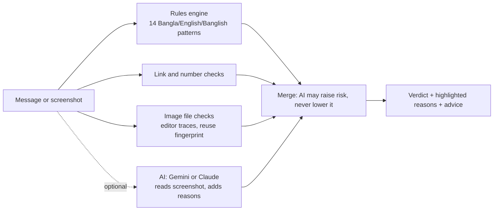

# Scam Shield: Mobile Money Scam Shield

**Live:** https://scam-shield-two-topaz.vercel.app  
Team **JU_Segfault** (Jahangirnagar University), CoU AI Hackathon 2026

Bangladesh runs on bKash, Nagad and Rocket. So do its scammers: fake "payment done" screenshots sent to online sellers, "wrong number, please send it back" calls, fake customer care asking for a PIN or OTP. Scam Shield checks *before* you act, in Bangla and English, and shows exactly why.

## What it does

| Tool | For | What happens |
|---|---|---|
| **Payment proof** | Online sellers | Upload the buyer's screenshot and what you expected. We compare amount, your number, payment time and TrxID; look for editing-app traces in the file; and catch the same screenshot or TrxID being reused for another order. Verdict: *matches / suspicious / likely fake*, never "safe". |
| **Message check** | Everyone | Paste an SMS or describe a call (Bangla, English, Banglish, or speak it). The exact risky words are highlighted, links and phone numbers are judged (look-alike domains, hidden short links, personal numbers posing as customer care), and you get plain advice plus official hotlines. |
| **Scam trainer** | Everyone | Three scripted scams with instant feedback, working offline. With an AI key, a free-chat mode where the AI plays the scammer and grades you. |
| **How it works** | Judges, users | Pipeline, live accuracy numbers, and the full pattern library, in the app itself. |
| **Offline mode** | Rural users, bad networks | Open the site once online and it is saved on the device. With no internet, message checks run in the browser with the same rules, and the trainer still works. |

## How it decides



- **Rules first.** Every warning traces back to a readable pattern (see `app/library.py` or the "How it works" tab). The app works fully without AI.
- **AI is conservative.** It reads screenshots and adds reasoning, but the merge never lowers a risk the rules found. Inputs are treated as untrusted (prompt-injection guarded).
- **Works offline.** `/api/rules` publishes the whole rule library as data; `app/static/engine.js` runs it in the browser, and a service worker keeps the app on the device. `tests/test_offline_parity.py` checks that the browser engine and the server engine give identical results on every evaluation message.
- **Never "safe".** The best payment verdict is "matches what you expected", with a reminder to confirm in your own app.

## Accuracy (be honest)

Rules only, on our own labelled set (`app/data/messages.csv`, 74 messages in Bangla, English and Banglish):

| Set | Scams flagged | Real messages wrongly flagged |
|---|---|---|
| Tuning (`dev`, 46) | 25 / 25 | 0 / 21 |
| Unseen (`holdout`, 28) | 13 / 13 | 0 / 15 |

The set is small and written by us; patterns were tuned on `dev` only. Treat it as a sanity check, not a benchmark. Reproduce with `python eval/run_eval.py` (add `--ai` to include the AI).

## Run it

```bash
python3 -m venv .venv && source .venv/bin/activate     # Windows: .venv\Scripts\activate
pip install -r requirements.txt
export GEMINI_API_KEY=...        # optional: free key at aistudio.google.com (or ANTHROPIC_API_KEY)
uvicorn app.main:app --port 8000
```
Open http://localhost:8000. Without a key it runs in rules mode, fully offline. `MOCK_LLM=1` gives canned AI replies for UI testing.

| Variable | Purpose |
|---|---|
| `GEMINI_API_KEY` | Enables AI via Google Gemini (used first if set) |
| `GEMINI_MODEL` | Default `gemini-3.5-flash-lite` |
| `ANTHROPIC_API_KEY`, `SHIELD_MODEL` | Alternative AI provider (Claude) |
| `RATE_LIMIT` | AI-backed requests per IP per minute (default 20) |

Tests: `python -m pytest -q tests` (also run by GitHub Actions on every push).

## API

`GET /api/status`, `/api/health`, `/api/meta`, `/api/metrics`, `/api/rules`, `/api/trainer/scenarios`  
`POST /api/pretx` `{text, lang}`, `POST /api/proof` (multipart: `image`, `expected_amount`, `expected_recipient`, `chat_time`, `order_ref`, `manual`), `POST /api/trainer/chat`, `POST /api/trainer/grade`.  
Interactive docs at `/docs`.

## Project layout

```
app/main.py        FastAPI app, endpoints, AI merge, rate limit
app/rules.py       rules engine with highlight spans
app/library.py     scam pattern library (Bangla, English, Banglish) and hotlines
app/entities.py    link and phone-number analysis
app/proof.py       payment proof comparison and verdict
app/forensics.py   image file checks (editor traces, perceptual fingerprint)
app/llm.py         Gemini / Claude client with mock mode
app/scenarios.py   trainer scenarios
app/static/        frontend (vanilla HTML/CSS/JS, no build step)
app/static/engine.js  offline copy of the rules engine (runs /api/rules data)
app/static/sw.js      service worker: keeps the app usable offline
app/data/          labelled evaluation messages
challenges/        on-site assigned challenges
```

## Limits

- It cannot prove a payment is real; only the seller's own account can.
- Editing-app traces can be stripped, and AI visual judgement is not forensics.
- TrxID and screenshot reuse are remembered per server instance only (on Vercel, per warm instance).
- New scam wording needs new patterns. No integration with bKash/Nagad systems.

## Credits

- Built by team JU_Segfault, with **Claude (Anthropic) as an AI coding assistant**.
- Runtime AI: Google Gemini API or Anthropic Claude API (optional).
- Libraries: FastAPI, Uvicorn, Pillow, httpx, python-multipart, anthropic SDK, pytest.
- Official hotline numbers from the providers' public pages. Scam patterns, scenarios and the evaluation set are our own work, written from public scam warnings.
- Project code started on or after 21 Nov 2026, per contest rules.
